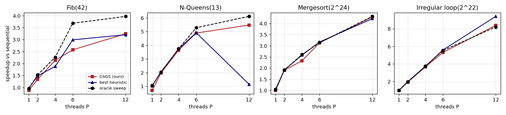

# CAGS: Cost-Aware Granularity Selection for OpenMP Tasks

Code, raw measurements and proofs for the paper

> M. Iqbal, R. A. Zaman, H. B. Naeem, and M. J. Shah,
> *When Does Fine-Grained Parallelism Pay Off? A Survey of Task Granularity and CPU Overheads, with Cost-Aware Granularity Selection.*

CAGS picks the task size at run time from the paper's own cost model. It needs no hand tuning:

1. **Sample the work.** On a warmed-up, quiet core, time short sequential runs of the kernel at increasing sizes to get `t(s)`.
2. **Measure overhead.** Time a burst of empty OpenMP tasks on the actual `P` threads, giving `h = P·T/N` CPU-seconds per task.
3. **Choose the grain.**
   - *Recursive kernels*: spawn children only while every child costs at least `θ = 2η/(1−η)·h`. This guarantees CPU efficiency `≥ η` (Theorem 9 in `proofs/PROOFS.md`; Theorem 1 in the paper).
   - *Loops*: pick the log-midpoint of the feasible interval `[max(ηh/(1−η), W/(QP)), W/(kP)]`. Here `Q = 64` is libgomp's task-queue cap; above it a taskloop silently runs serially (Proposition 11).

The time spent measuring and sampling **is included** in every reported CAGS result.

## What is new, and related work

Run-time granularity control is not new. To our knowledge, CAGS differs from earlier methods in four ways:

1. **The threshold comes from an explicit efficiency target `η` and the overhead `h` measured on the actual thread count**, contention included. We measured `h` rising from 0.03 µs at 1 thread to 8.5 µs at 12 threads, so a constant tuned once per machine cannot fit every thread count.
2. **No programmer cost functions, and no compiler or runtime changes.** It runs on stock OpenMP (GCC libgomp).
3. **The runtime's own task-queue cap is part of the model.** libgomp silently serializes a `taskloop` that would exceed 64×P queued tasks; CAGS's loop rule provably stays under the cap.
4. **The guarantee bounds total CPU, not only time**, and CAGS is charged for its own decision cost in every result.

| Method | Decision signal | Programmer input | Toolchain change | Provable bound |
|---|---|---|---|---|
| Lazy task creation (Mohr et al., TPDS 1991) | idle worker asks for work | none | runtime + compiler | none known |
| Adaptive cut-off (Duran et al., SC 2008) | profiled subtree cost | none | OpenMP runtime | none known |
| AdaptiveTC (Wang et al., CGO 2010) | demand for tasks | none | Cilk system | none known |
| Lazy binary splitting (Tzannes et al., PPoPP 2010) | local queue state | none | runtime scheduler | none known |
| Multiversioning (Thoman et al., CCPE 2014) | local task demand | none | compiler + runtime | none known |
| Static cut-off (Iwasaki & Taura, PACT 2016) | compile-time analysis | none | compiler | none known |
| Oracle-guided (Acar et al., JFP 2016; PPoPP 2019) | predicted cost | cost function per parallel function; κ tuned per machine | runtime (Cilk extension) | time |
| Heartbeat (Acar et al., PLDI 2018; Su et al., ASPLOS 2024) | periodic heartbeat | none | runtime + compiler | time |
| **CAGS (this work)** | sampled `t(s)` + measured `h` per P | size parameter; monotone cost | **none (stock OpenMP)** | **CPU and time** |

## Layout

| Path | Contents |
|---|---|
| `src/cagran.c` | All kernels (Fib, N-Queens, mergesort, irregular loop), all baselines, and CAGS |
| `bench/run_all.py` | Runs every experiment in the paper; writes `results/raw.csv` |
| `bench/analyze.py` | Medians, speedups, oracle sweep; writes `results/summary.csv`, the LaTeX tables/figures in `results/latex/`, and `results/figures/speedup.png` |
| `proofs/PROOFS.md` | Complete proofs of every analytical statement in the paper (Props. 1–7) and of the CAGS guarantees (Lemma 8 – Prop. 12) |
| `analytical/analytical_examples.py` | Reproduces the paper's hypothetical worked examples (Table III) |
| `results/` | Raw CSV and environment description of the run reported in the paper |

## Reproduce

Requirements: GCC with OpenMP (libgomp), Python 3. matplotlib is optional and only used for the PNG.

```bash
make                        # builds ./cagran
python3 bench/run_all.py    # full suite, about 11 min on a 6-core laptop
python3 bench/analyze.py    # tables, figures, summary
```

Single runs:

```bash
./cagran fib cags 12 5 42                # kernel variant threads reps size [cutoff]
CAGS_ETA=0.95 ./cagran loop cags 6 3 4194304
./cagran nqueens fixed 12 3 13 10        # fixed cutoff (used for the oracle sweep)
```

Every row is checked for correctness: the Fibonacci value, the known N-Queens solution count, sortedness, and the loop checksum. The program exits on any failure.

## Results

Median of 5 runs on an AMD Ryzen 5 7430U (6 cores / 12 threads), GCC 16.2 `-O2`, libgomp, AC power.
Results at **P = 12**. CAGS times include its own measurement and sampling.

| Kernel | Sequential | CAGS | Best usual practice | Oracle\* | CAGS / oracle |
|---|---|---|---|---|---|
| Fib(42) | 0.307 s | 0.095 s (3.24×) | depth cutoff 0.096 s (3.20×) | 0.077 s | 1.22 |
| N-Queens(13) | 0.489 s | **0.089 s (5.48×)** | depth cutoff 0.424 s (1.15×) | 0.080 s | 1.12 |
| Mergesort(2^24) | 1.376 s | 0.320 s (4.29×) | depth cutoff 0.326 s (4.21×) | 0.319 s | 1.01 |
| Irregular loop(2^22) | 0.594 s | 0.071 s (8.40×) | `guided` 0.063 s (9.42×); default `taskloop` 0.115 s (5.15×) | 0.072 s | 0.98 |

\*Best fixed cutoff from an exhaustive sweep. Its search time is not counted.

Highlights:
- **N-Queens:** CAGS is 4.75× faster than the usual depth cutoff while using about one fifth of the CPU time (1.95× vs 9.63× sequential CPU).
- **Irregular loop:** 1.63× faster than OpenMP's default `taskloop`.
- **Every-call tasking:** a task at every call makes Fib(34) more than 2,000× slower than sequential. `taskloop grainsize(1)` silently serializes because of libgomp's queue cap.
- **Theorem 9 holds:** the measured `N_t·h/W` stays ≤ 0.085 for Fib and mergesort, against a bound of 0.111.
- **Where it loses:** 13–42% slower at P = 1 on Fib and N-Queens; `guided` beats it on the loop; the oracle is 22% faster on Fib.



Full numbers: `results/summary.csv`. Raw per-run data: `results/raw.csv`.

## Caveats

- One machine, a laptop CPU with SMT and dynamic frequency scaling, and one OpenMP runtime (GCC libgomp). The numbers will differ on other hardware and runtimes. That is the point of measuring `h` at run time.
- The oracle is the best fixed cutoff from an exhaustive sweep. Its search time is not counted, so it is an optimistic reference.
- Theorem 9 assumes cost grows monotonically with size. N-Queens violates this, so its results are empirical only (see `proofs/PROOFS.md`).

## License

MIT, see `LICENSE`.
